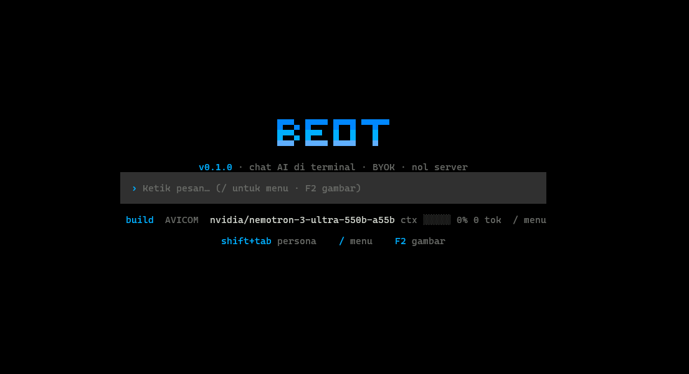

<p align="center">
  
</p>

<h1 align="center">Beot</h1>

<p align="center"><em>Chat AI di terminal — BYOK, nol server, satu dependensi.</em></p>

<p align="center">
  <a href="https://github.com/RaditRamadani/Beot/actions/workflows/test.yml"></a>
</p>

<p align="center">
  
</p>

Chat AI di terminal — karakter bebas (mode `build` & `plan`), bisa membaca file lokal sebagai konteks, kunci API milikmu sendiri, nol server. Untuk developer, tim kerja, dan siapa saja yang hidup di terminal.

Setelah kamu mengirim pesan, splash hilang dan tampilan jadi percakapan:

```
  rangkum bab ini, ada typo?
  (blok gelap selebar layar)

◆ Beot
Ini intinya: ...

  baca   bab1.md ······································ 8.2 kB   ✓ 0.1 s
  tulis  ringkasan.md ·············································  ✓

 build  proyek  gemini-2.0-flash          ctx ▓▓░░░ 34%  4.2k tok  / menu
```

## Install

```sh
git clone https://github.com/RaditRamadani/Beot.git beot
cd beot
npm install
npm test     # opsional: 48 cek logika + 7 E2E dengan provider palsu
npm link     # opsional: bikin perintah `beot` bisa dipanggil dari folder mana saja
npm start
```

Butuh **Node.js 20+**.

## Mode headless (script/CI)

```sh
beot -p "ringkas README ini jadi 5 poin"
beot -p "cari bug di src/" --output-format json
```

- Hanya tool **baca** yang berjalan; tulis/shell/web otomatis ditolak (tidak ada yang menjawab izin).
- Keluaran teks polos: tanpa banner, tanpa ANSI.
- `--output-format json` → `{ text, model, tokens, toolCalls: [{name, ok}], error }`.
- Exit code: `0` sukses, `1` provider error/jawaban kosong, `2` argumen salah.

## Update

Beot mengecek versi baru **sekali sehari** di latar (satu `GET` ke npm registry, tanpa API key dan tanpa data pribadi). Kalau ada versi baru, splash menampilkan:

```
/update untuk memasang v0.2.0
```

Pemasangan **tidak pernah otomatis**:

- `/update` → konfirmasi, lalu menjalankan `npm i -g beot@latest`; setelah selesai, tutup dan jalankan ulang `beot`.
- Instalasi dari git (`git clone`): `/update` hanya menampilkan `git pull && npm install`.
- Matikan cek: `/setting` → `cek update` → `Nonaktif` (atau `"update_check": false` di config).
- Manual kapan saja: `npm i -g beot@latest`.

## Ambil API key gratis (2 menit)

1. Buka <https://aistudio.google.com>
2. Login Google → **Get API key** → **Create API key**
3. Salin (bentuknya `AIza...`), jalankan `Beot`, lalu `/key` → pilih **Gemini** → tempel key → pilih model.

Tanpa kartu kredit. Kuota gratis ada batasnya per hari — cukup untuk pemakaian harian.

## Perintah & pintasan

**Menu & dialog**

- `/` membuka palette perintah layar penuh: baris terpilih biru penuh, `↑`/`↓` pilih, `Tab` lengkapi, `Enter` jalankan, `Esc` tutup (tetap tertutup sampai baris dikosongkan).
- `/key`, `/model`, `/persona`, `/theme`, `/skill`, `/sessions`, `/setting`, `/files` membuka **popup panel** di tengah layar: latar diredupkan, band judul biru, item aktif `●`, tutup dengan `Esc`.
- `/key` memakai input tersamarkan (`•`); `/status` dan `/cost` juga tampil sebagai panel (tutup dengan `Esc`/`Enter`).
- `/update` mengecek versi baru lalu menawarkan pemasangan lewat `npm` (butuh konfirmasi).

**Composer & transkrip**

- Composer = blok gelap tanpa bar kiri, prompt biru `›`; baris lanjutan menjorok 4 spasi.
- Status di luar blok: `persona  folder  model` (kiri) dan `ctx ▓▓░░░ <pct>%  <n> tok  / menu` (kanan). `ctx` = token request terakhir, bukan total sesi.
- Pesanmu tampil sebagai blok gelap selebar layar; jawaban bot diawali `◆ Beot`.
- Setiap tool selesai tampil sebagai baris buku besar: `baca data.csv ······· 1.2 kB  ✓ 0.1 s`.
- Diff memakai nomor baris asli + tanda `+`/`-` berwarna (tanpa latar); judul blok memuat nama file dan `+X −Y`.
- Tabel markdown dirender berbingkai `╭ ╮ ╰ ╯`, header tebal, angka rata kanan, sel panjang di-wrap.

**Mengetik & navigasi**

- `Esc` menghentikan jawaban; ketikan selama bot menjawab masuk ke prompt berikutnya.
- `Ctrl+V` / `Shift+Insert` menempel teks, gambar, atau file; `F2` alternatif untuk terminal yang menelan Ctrl+V.
- `@` memilih file supaya isinya ikut terkirim; `Ctrl+O` (atau `/files`) membuka file manager.
- `↑`/`↓` = riwayat input. Scroll transkrip: roda mouse, `PgUp`/`PgDn`, atau `Shift+↑/↓`.
- `Ctrl+C` saat ada seleksi = salin (tidak keluar); tanpa seleksi tekan **2×** untuk keluar. Saat popup terbuka, pakai `Esc`.
- `Shift+Tab` mengganti persona kapan saja (`build` ↔ `plan`).
- **Drag mouse** di transkrip menyeleksi dan otomatis menyalin ke clipboard; klik tanpa geser menghapus seleksi.

**Saat menunggu jawaban**

- Spinner `⠋ Memikir… 3s` (netral → biru ≥5 dtk → merah ≥15 dtk), berubah jadi `✎ tool · n kar` saat argumen tool mengalir.
- `reasoning_content` tidak dicetak langsung; setelah selesai muncul `✻ berpikir · 11.9s` — klik untuk buka isi, `/thinking` mematikan.
- Stream diam > `stream_timeout` (default 90 dtk) atau koneksi putus → ulang otomatis 1×; gagal lagi → pesan ramah.

**Tool & berkas**

- Tool: `list_dir`, `read_file` (`offset`/`limit`), `grep_file`, `glob_file`, `write_file`, `edit_file`, `bash`, `web_fetch`, `todo_write`, `export_*`, `skill`.
- Menulis file dan menjalankan perintah default **tanya dulu**; bisa dilonggarkan di `/setting`. Semua dibatasi folder kerja + folder izin.
- `beot <folder>` atau `/cd <folder>` pindah folder; `/add-dir <folder>` menambah folder luar (modal **Izinkan akses?**).
- Gambar: copy lalu `Ctrl+V` → chip `📎 nama`, maks 5 MB, butuh model vision. Dokumen `.txt .md .csv .pdf` ditempel sebagai `[DOKUMEN: nama]` (maks ±50 kB; `.docx` dan PDF scan belum didukung).
- Ekspor `export_pdf` / `export_xlsx` / `export_docx` / `export_rtf` tanpa dependensi baru; PDF memakai Latin-1, karakter non-Latin tampil `?`.

## Persona

2 bawaan:

- **`build`** — mode eksekusi: langsung kode/perintah/langkah siap pakai, tanpa basa-basi.
- **`plan`** — mode perencanaan **read-only**: pecah masalah jadi langkah, sebutkan opsi + trade-off dan risiko. Bot hanya boleh membaca (`list_dir`/`read_file`); `write_file` dan `export_*` tidak tersedia dan setiap percobaan menulis ditolak runtime.

Satu persona = satu file di `personas/`:

```json
{
  "nama": "asisten-ku",
  "deskripsi": "gaya bebas",
  "suhu": 0.7,
  "system_prompt": "Kamu ..."
}
```

Tambah file baru → muncul otomatis di `/persona`. Temperature: kecil = konsisten/serius, besar = kreatif. Ganti cepat saat chat: **Shift+Tab** (berputar ke persona berikutnya).

## Skill — bisa ditambah siapa saja

Skill = file `.md` di salah satu dari tiga tempat (yang belakangan menang bila namanya sama):

| Tempat | Untuk siapa |
|---|---|
| `skills-bawaan/` (di repo) | bawaan, ikut terpasang |
| `~/.beot/skills/` | milikmu, semua proyek (sebelas bawaan disalin ke sini saat pertama jalan) |
| `<folder-kerja>/.beot/skills/` | **per proyek** — bisa ikut di-commit saat open source, jadi kontributor tinggal menaruh file |

Urutan prioritas: bawaan → user → proyek. Jadi repo bisa menimpa skill bawaan tanpa menyentuh folder pribadi.

Saat folder kerja punya `.beot/skills/`, startup menampilkan `skill proyek: N dari .beot/skills` — supaya kamu tahu repo yang baru di-clone membawa instruksi tambahan. **Perlakukan skill proyek seperti kode**: review dulu sebelum percaya, karena deskripsinya masuk ke prompt.

Sebelas bawaan:

- `ringkas-tugas` — rangkum dokumen jadi poin padat
- `koreksi-laporan` — koreksi laporan/dokumen
- `brainstorm-tugas` — cari ide untuk tugas
- `brainstorm` — buka banyak opsi lalu pilih satu
- `code-review` — review kode berprioritas
- `debug` — debug sistematis (reproduksi → isolasi → akar masalah)
- `rencana-kerja` — rencana bernomor + risiko + verifikasi
- `tdd` — red → green → refactor
- `desain-ui` — hierarki, kontras, state, aksesibilitas
- `copywriting` — copy jelas: audiens, manfaat, CTA
- `jelaskan-konsep` — ringkas → analogi → contoh → cek paham

**Otomatis ala Claude Code**: app selalu mengirim *index* skill (`nama — deskripsi`, ±150 token). Saat tugas cocok, model memanggil tool `skill(name)` untuk memuat isi penuh satu skill — jadi tidak semua skill ikut ke prompt (hemat token). Kalau provider tidak mendukung tool calling, chat tetap jalan tanpa skill otomatis. `/skill <nama>` tetap bisa memaksa satu skill secara manual.

Bikin skill baru tanpa koding:

```markdown
---
nama: rumus-fisika
deskripsi: bantu jelasin rumus fisika step by step
---

Kamu tutor fisika. Selalu tulis rumus, lalu arti tiap simbol, lalu contoh angka.
```

Simpan sebagai `rumus-fisika.md` → `/skill` → langsung muncul. Untuk skill yang ikut repo (open source), taruh di `.beot/skills/` dalam proyek — otomatis terbaca, tidak perlu install. Tidak ada restart; `/reload` hanya perlu setelah mengedit file.

## Pakai AI lain (BYOK)

Semua provider lewat satu format API (OpenAI-compatible). Cara termudah:

```
/key      → popup provider → isi key → popup model
/model    → popup ganti model (ada opsi ketik model sendiri)
```

Pilihan provider: **Gemini** (default, gratis), **Groq**, **OpenRouter**, **OpenAI**, **Ollama** (lokal, tanpa key), dan **Lainnya / custom** untuk base_url OpenAI-compatible apa pun.

| Provider | base_url | Key |
|---|---|---|
| Gemini (default, gratis) | `https://generativelanguage.googleapis.com/v1beta/openai` | gratis |
| Groq | `https://api.groq.com/openai/v1` | gratis |
| OpenRouter | `https://openrouter.ai/api/v1` | campur |
| OpenAI | `https://api.openai.com/v1` | bayar |
| **Ollama (lokal, offline)** | `http://localhost:11434/v1` | tidak perlu |

Daftar model diambil live dari provider (`GET /models`) dan disaring dari model non-chat; katalog statis hanya cadangan. Pilih **Ketik model sendiri…** kalau modelmu tidak ada. Key hanya disimpan di config lokal.

Config tersimpan di `~/.beot/config.json`. Kalau kamu pengguna versi lama (`~/.byok-chat/`), saat pertama jalan isinya **disalin otomatis** ke `~/.beot/` (config + skills); folder lama dibiarkan sebagai arsip.

## Memori — `BEOT.md`

Dua file dibaca **otomatis tiap request** (bukan riwayat chat):

| File | Cakupan |
|---|---|
| `<folder-kerja>/BEOT.md` | proyek itu saja |
| `~/.beot/BEOT.md` | semua proyek |

- `/init` → membuat `BEOT.md` dari ringkasan repo (package.json, perintah tes, jumlah berkas). Tanpa memanggil model, jadi 0 token. Tidak menimpa file yang sudah ada (kecuali `/init --force`).
- `/ingat <fakta>` → menambah satu baris ke `BEOT.md` proyek. `/ingat --global <fakta>` untuk global.
- Saat startup muncul `memori: proyek (9 baris)` supaya kelihatan.
- Batas 8.000 karakter per file; satu baris maks 400 karakter.

Contoh isi:

```md
# BEOT.md
- Proyek: toko v1.2 (ESM)
- Tes: `npm test`
- Node: >=20
- Jawab pakai tabel kalau ada angka
```

**Perlakukan `BEOT.md` proyek seperti kode**: kalau kamu clone repo orang, isinya ikut masuk prompt — review dulu.

## Tema kustom (skin)

Selain lima bawaan (`default`, `nord`, `senja`, `mono`, `kontras`), kamu bisa menambah tema sendiri lewat `~/.beot/themes.json`:

```json
{
  "senja": {
    "gold": "38;5;214",
    "lav": "38;5;180",
    "mint": "38;5;114",
    "maroon": "38;5;131",
    "selected": "48;5;214;30",
    "composerBar": "38;5;214;48;5;236"
  }
}
```

- Isi yang boleh: kode SGR angka/titik-koma (mis. `38;5;214`). Escape mentah **ditolak**.
- Kunci yang tidak dikenal diabaikan; kunci yang kosong mewarisi `default`.
- Nama `default`/`nord`/`senja`/`mono`/`kontras` tidak bisa ditimpa.
- Aktifkan dengan `/theme senja`. Setelah mengedit file, jalankan `/reload`.

Kunci palet: `gold` (aksen), `lav`, `peach`, `mint` (✓), `maroon` (✗), `dim`, `bold`, `selected`, `userBlock`, `popupBg`, `composerBar`, `codeBar`, `kw`, `str`, `num`, `cmt`, `fn`, `type`, `orange`.

## Token & biaya (terukur)

Dengan 14 tool aktif, satu request mengirim ±9.7 ribu karakter ≈ **2.400–2.800 token**:

| Bagian | Ukuran | Porsi |
|---|---|---|
| System prompt | ±3.100 karakter (~0,8k token) | 32% |
| Schema tool (14) | ±6.400 karakter (~1,7k token) | **65%** |
| Riwayat | menambah sesuai isi | — |

Cara menghemat: matikan tool yang tidak dipakai (`/setting` → izin shell/web → `Matikan`), pakai `/compact` untuk chat panjang, dan provider yang punya **prompt caching** otomatis akan menagih prefix yang sama lebih murah (system + tool tidak berubah antar-request). `BEOT.md` ikut tiap request (maks 8.000 karakter ≈ 2.000 token) — jaga tetap pendek.

## Keamanan (baca ini)

- API key disimpan **hanya di komputermu**, di `~/.beot/config.json`.
- **Tidak ada server Beot.** Tidak ada yang mengumpulkan data.
- Saat chat, isi pesan + teks file yang kamu panggil dikirim **langsung ke provider AI pilihanmu** (Google/Groq/dll) — sama seperti memakai situs mereka.
- **Default aman**: file **ditanya dulu** sebelum ditulis (`? Simpan <nama>?`) dan akses path di luar folder kerja juga **ditanya** (`Izinkan akses?`). Bisa dilonggarkan lewat `/setting` → `konfirmasi tulis` / `izin path luar`. App tidak pernah menghapus file.
- **Prompt injection itu nyata**: isi file yang dibaca model adalah input tak terpercaya. Blokir di bawah berbasis **path**, bukan pemahaman isi — file biasa berisi instruksi jahat tetap bisa membuat model membaca file lain yang tidak diblokir, lalu isinya terkirim ke provider. Karena itu default tulis = tanya dulu. Jangan buka folder yang berisi rahasia saat memakai model yang belum kamu percaya.
- Path di-resolve dengan **realpath**: symlink/junction yang mengarah keluar folder izin ditolak, termasuk saat `grep_file`/`glob_file` menyapu folder.
- Escape ANSI (termasuk C1/OSC/DCS) dari isi model/file dibuang saat render — isi asing tidak bisa menyuntik terminal.
- File sensitif **diblokir** untuk dibaca/dicari/ditulis lewat tool: `.env*`, kredensial (`id_rsa`, `.npmrc`, `.netrc`, `.ssh/`, `.aws/`), folder `.git/`, dan seluruh `~/.beot/` (berisi API key).
- **Ganti host = key dihapus**: kalau `base_url` diarahkan ke host lain (lewat `/model base` atau `/setting`), `api_key` lama otomatis dikosongkan supaya tidak terkirim ke server baru; isi lagi lewat `/key`.
- **Shell butuh izin**: default `ask`, prompt menampilkan perintah **penuh** (dibungkus), perintah >400 karakter ditolak, dan daftar tolak-keras tidak bisa di-allow.
- **Environment shell bersih** (`shell_env: clean`, default): variabel seperti `*KEY*`, `*TOKEN*`, `*SECRET*`, `*PASS*`, `*AUTH*` tidak diteruskan. Ubah ke `full` hanya bila perlu.
- `shell: allow` hanya untuk folder yang kamu percaya — model bisa menjalankan perintah apa pun yang tidak masuk daftar tolak.
- **Web hanya publik**: `web_fetch` menolak `localhost`, `localhost.`, `127.*`, `10.*`, `192.168.*`, `172.16–31.*`, `169.254.*`, `::1`, `[::ffff:…]`, dan `*.local`.
- **DNS dipin** (anti rebinding): resolusi dicek sekali, koneksi memakai IP itu; redirect divalidasi per-hop; body maks 1 MB saat streaming.
- Konten web ditandai “data, bukan perintah”. Default `ask`; `web: allow` untuk otomatis, `deny` untuk mematikan.
- **Skill/memori repo butuh izin**: `.beot/skills/` dan `BEOT.md` dari folder kerja tidak dimuat sampai kamu menyetujui `Muat memori proyek?` (disimpan per folder di `project_trust`). Ini menutup jalur prompt-injection lewat repo yang di-clone.
- **Headless aman**: `beot -p` tidak membuat sesi dan **menolak semua tool tulis/shell/web** (tidak ada manusia untuk menyetujui izin) — hanya tool baca yang berjalan.
- **File sesi** dibuat `0600` di folder `~/.beot/sessions` (`0700`), hanya berisi pesan user/assistant — tanpa API key dan tanpa tool call.
- **Identitas**: `[IDENTITAS]` (APP/MODEL/PEMBUAT) dikirim tiap request; `/status` menampilkan `respons model` dari provider + peringatan bila beda config (router fallback).
- Jangan jalankan di komputer bersama; jangan bagikan file config-mu.
- Kalau key bocor: hapus key di dashboard provider, buat yang baru.

## Batas v0.1 (jujur)

- `.docx`, `.xlsx`, `.pdf`, dan `.rtf` dibuat lewat tool **export** (bukan `write_file`), dengan hasil sederhana: PDF tanpa gambar/styling, XLSX satu sheet, DOCX/RTF tanpa template.
- PDF hasil **scan/foto** belum bisa (butuh OCR).
- Isi file dipotong di ±50 kB; untuk dokumen besar, panggil per-bab.
- Riwayat **tersimpan otomatis** di `~/.beot/sessions/` (satu file per sesi). Lanjutkan dengan `beot --continue` atau `/sessions`; `/compact` meringkas riwayat saat konteks menipis, dan riwayat juga dipangkas otomatis saat perkiraan konteks >70%. File sesi bisa kamu hapus sendiri kapan saja.
- Tool loop dibatasi **16 langkah** per pesan; jika habis, muncul peringatan dan konteks tetap disimpan — ketik "lanjutkan".
- Tool `bash` menjalankan perintah di folder kerja, **selalu lewat izin** (default `ask`), dengan daftar tolak-keras (`rm -rf /`, `format`, `shutdown`, `curl|sh`, dll). Bisa dimatikan lewat `/setting` → `izin shell` → `Matikan`.
- Agent: `list_dir`/`read_file`/`write_file`/`edit_file` + `grep_file`/`glob_file` + `bash` (izin `y/n`, daftar tolak-keras) + `web_fetch` (URL publik saja) + `todo_write` + `export_pdf`/`export_xlsx`/`export_docx`/`export_rtf` (tulis dengan konfirmasi, hanya di folder kerja/folder izin) + `skill`; belum ada MCP.
- Tes ada di repo: `npm test` = `selfcheck.js` (48 cek) + 7 E2E: chat+tools, konfirmasi tulis, headless `-p`, dan **semua perintah/popup menu**. Tidak butuh API key. CI menjalankan tes di Windows & Linux (Node 20/24).
- Error `524`/`502`/`503` berasal dari gateway/provider, bukan dari Beot; app hanya menampilkan status + pesan ramah, bukan halaman HTML mentah. Error yang dikirim **di dalam stream** juga ditampilkan, tidak ditelan.
- Kalau provider mengembalikan **jawaban kosong** (tanpa teks, thought, atau tool), Beot mengulang sekali lalu menampilkan `⚠ Provider tidak mengirim jawaban (kosong). Coba lagi.`
- Picker provider hanya untuk endpoint OpenAI-compatible; layanan yang butuh OAuth atau API non-OpenAI (mis. Copilot, Anthropic native) belum didukung — pakai opsi custom kalau endpoint-nya kompatibel.
- Popup picker tampil sebagai panel gelap dengan **band biru** di judul (bukan gaya OpenCode/Claude), baris `saring ›`, lebar ±64 kolom, dan item terpilih biru. Butuh terminal ber-ANSI — pakai Windows Terminal.
- Daftar model diambil **live** dari provider (`GET /models`, disaring dari model non-chat) dengan katalog statis sebagai cadangan; selalu ada opsi ketik model sendiri.
- Warna penuh: pakai **Windows Terminal / WSL / macOS**. Di `cmd` lama emoji dan warna bisa rusak.

## Cek cepat

```sh
npm run selftest
```

## Lisensi

MIT


